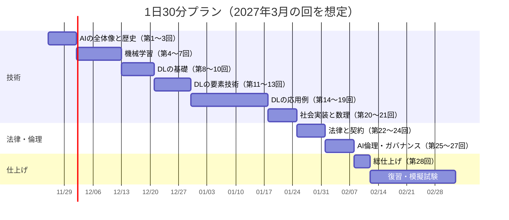

STUDY PLAN

# 学習計画（1日30分）

全28回・約40時間の講義を、試験日から逆算して進める。

受験予定：未定
1日30分
AIの知識：仕事で少し使う

!!! news "最終更新：2026-11-24"
    2027年第2回以降の日程はまだ発表されていない。発表されたら、試験日から逆算してこの計画を組み直す。

## 前提

| 項目 | 内容 |
|---|---|
| 1日の勉強時間 | 30分 |
| 講義の合計 | 28回・約40時間（2,370分） |
| 講義だけにかかる日数 | 1日30分で約79日 |
| 復習にほしい期間 | 2〜3週間（一問一答・模擬試験・苦手つぶし） |

## 受ける回の候補

| 候補 | 試験日 | 試験まで | 1日30分で使える時間 | 判断 |
|---|---|---|---|---|
| 2027年第1回 | 2027/1/16(土) | 約53日 | 約26時間 | 講義が終わらない。1日45〜60分に増やせるなら挑戦できる |
| **2027年3月の回（予想）** | 未発表（2026年は3/6・3/7） | 約100日 | 約50時間 | 全講義＋復習3週間がちょうど入る。**おすすめ** |

!!! tip "申込を忘れない"
    申込受付は例年「試験の約1か月半前〜約1週間前」。受験チケットは購入から1年間有効なので、先に買っておいてもよい。

## おすすめプラン（2027年3月の回を目標）

| 期間（目安） | 内容 | 講義 | 日数 |
|---|---|---|---|
| 11/25〜12/1 | AIの全体像と歴史 | 第1〜3回 | 7日 |
| 12/2〜12/12 | 機械学習 | 第4〜7回 | 11日 |
| 12/13〜12/20 | ディープラーニングの基礎 | 第8〜10回 | 8日 |
| 12/21〜12/29 | ディープラーニングの要素技術 | 第11〜13回 | 9日 |
| 12/30〜1/17 | ディープラーニングの応用例 | 第14〜19回 | 19日 |
| 1/18〜1/24 | 社会実装と数理・統計 | 第20〜21回 | 7日 |
| 1/25〜1/31 | AIに関する法律と契約 | 第22〜24回 | 7日 |
| 2/1〜2/7 | AI倫理・AIガバナンス | 第25〜27回 | 7日 |
| 2/8〜2/11 | 総仕上げ（模擬試験） | 第28回 | 4日 |
| 2/12〜試験日 | 一問一答・苦手分野の復習・模擬試験2回目 | — | 約3週間 |

## 1日30分の使い方

1. **前回の確認テストを解き直す（5分）**：間違えた問題だけでOK。
2. **講義を読む（20分）**：図を見てから本文。わからない語はメモして質問する。
3. **今日のまとめ表を見て、用語を声に出す（5分）**：一問一答の代わり。

## 進み具合と苦手分野の記録

講義が進んだら、ここに記録して復習の計画に使う。

| 日付 | 進んだ回 | 確認テスト | 苦手・質問したこと |
|---|---|---|---|
| — | — | — | — |
