

第1回 ｜ AIの全体像と歴史

# 人工知能とは？ 定義と「AIの難問」

「AIって結局なに？」に自分の言葉で答えられるようになる回。チューリングテスト、中国語の部屋、フレーム問題など、70年以上議論されてきた「AIの難問」を図で押さえる。

T01 人工知能の定義
T02 人工知能分野で議論される問題
⏱ 目安60分
キーワード18語

## 今日のゴール

この回が終わったら、こう言えればOK

- 人工知能・機械学習・ディープラーニングの関係（入れ子）と、AI効果・エージェントを説明できる
- チューリングテスト・中国語の部屋・強いAIと弱いAIを、提案者と年代つきで答えられる
- フレーム問題・シンボルグラウンディング問題・知識獲得のボトルネック・トイ・プロブレムの違いを説明できる
- ルールベース機械翻訳と統計的機械翻訳の違い、シンギュラリティの予測（誰が・何年）を答えられる

## 全体像

<figure markdown>
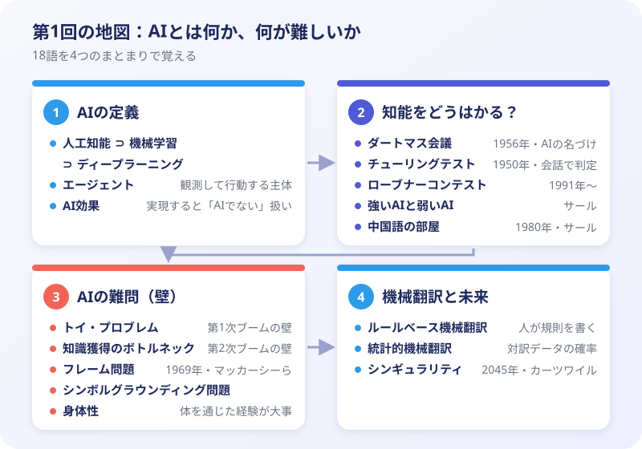
<figcaption>図：第1回の地図。18語を4つのまとまりで覚える</figcaption>
</figure>

左上から順に読む。①まず「AIとは何か」を定義し、②「機械に知能があるか、どうやって確かめるか」を考え、③実際に作ろうとしてぶつかった「難問（壁）」を知る。④最後に、AIの考え方の変化がよく見える機械翻訳の歴史と、未来の予測（シンギュラリティ）を見る。

この回に出てくる出来事を年表にすると、次のようになる。人名と年はセットで覚える。

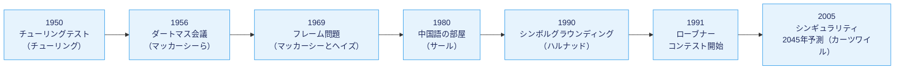

## 本題

### A. 人工知能の定義（T01）

#### 人工知能

人工知能（AI：Artificial Intelligence）T01

<strong>ひとことで：</strong>推論・学習・判断など、人間の知的なふるまいをコンピュータで実現しようとする技術や研究分野。ただし、<strong>専門家の間でも定義は統一されていない</strong>。

**仕組み（定義が1つに決まらない理由）**

「知能とは何か」自体が、人間についてもはっきり決まっていない。そのため、AIの定義も研究者ごとに少しずつ違う。代表的なものを2つ挙げる。

- **ジョン・マッカーシー**（「人工知能」という言葉の名づけ親）：「知的な機械、とくに知的なコンピュータプログラムを作る科学と工学」
- **松尾豊**（東京大学）：「人工的につくられた人間のような知能、ないしはそれをつくる技術」

どちらも「知能」という言葉を使って説明しており、「知能」の中身までは決めていない。だから試験では「AIの定義は**ただ1つに決まっている**」という選択肢は誤りになる。

<figure markdown>
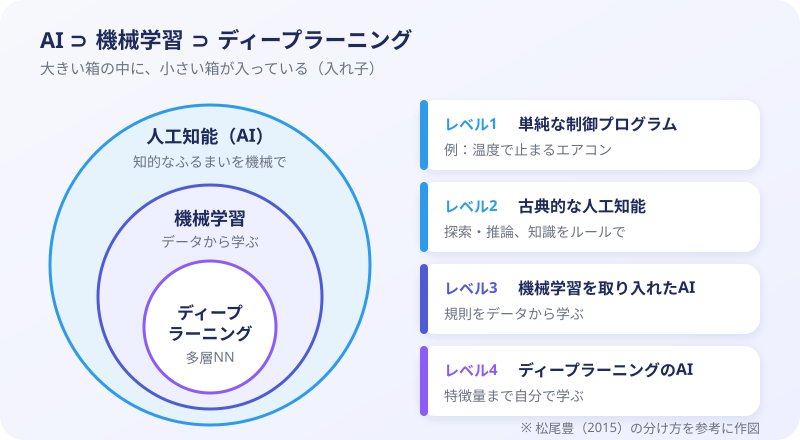
<figcaption>図：AI ⊃ 機械学習 ⊃ ディープラーニングと、AIのレベル分け</figcaption>
</figure>

**AIのレベル分け**：「AI搭載」と書かれた製品でも中身はさまざまだ。松尾豊（2015）は、次の4段階に分けて説明している。

1. **レベル1 単純な制御プログラム**：決められた条件で動くだけ。例：設定温度になると止まるエアコン。「AI搭載家電」の宣伝に多い。
2. **レベル2 古典的な人工知能**：探索・推論や、人が書いた知識（ルール）を使って、ふるまいのパターンが多い。例：掃除ロボット、将棋の初期のプログラム、診断プログラム。
3. **レベル3 機械学習を取り入れた人工知能**：判断の規則を、人が書く代わりにデータから学ぶ。例：検索エンジン、迷惑メールの判定。
4. **レベル4 ディープラーニングを取り入れた人工知能**：何に注目すればよいか（**特徴量**）まで、データから自分で学ぶ。例：画像認識、音声認識。

**具体例**：スマホの顔認証（レベル4）、エアコンの自動運転（レベル1〜3。製品によって違う）、乗換案内の経路探索（レベル2）。

!!! point "試験ではこう出る"
    - 「人工知能の定義は研究者によって異なり、統一された定義はない」が正しい選択肢になる。
    - 人工知能・機械学習・ディープラーニングの**包含関係**（AI ⊃ 機械学習 ⊃ ディープラーニング）を問う。

#### AI効果

AI効果T01

<strong>ひとことで：</strong>ある技術がAIで実現され、仕組みがわかると、人々が「それは単なる自動化で、知能ではない」と考えるようになり、AIと呼ばれなくなる現象。

**仕組み**

<figure markdown>
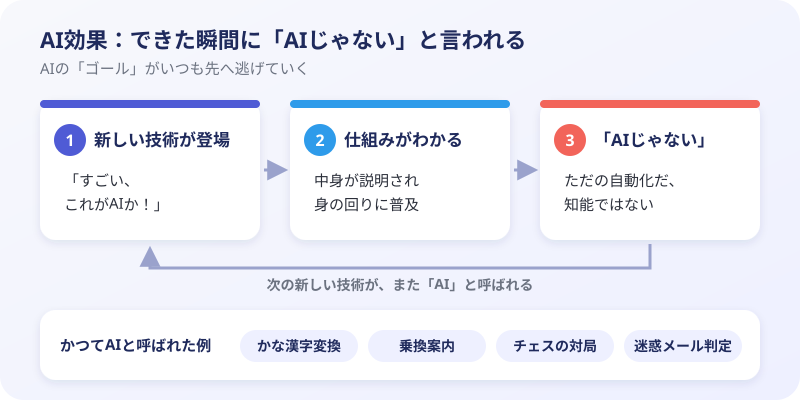
<figcaption>図：AI効果。「AI」のゴールはいつも先へ逃げていく</figcaption>
</figure>

新しい技術が出たときは「すごい、これがAIか」と驚かれる。しかし中身が説明され、身の回りに広まると、「決められた手順で計算しているだけだ」と感じられ、AIとは呼ばれなくなる。その結果、「AI」と呼ばれるのはいつも「まだ実現されていない、すごそうなもの」になり、AIの研究はいつまでも成果が出ていないように見えてしまう。

**具体例**：かな漢字変換、乗換案内の経路探索、チェスで人間に勝つプログラム、迷惑メールの自動判定。どれも登場したころはAIの成果だったが、今では「ふつうの機能」と思われている。

| | AI効果 | シンギュラリティ |
|---|---|---|
| ひとことで | 実現した技術がAIと呼ばれなくなる | AIが人間の知能を超える転換点 |
| 何についての話か | 人々の受け止め方（心理） | 技術の未来の予測 |
| 時間の向き | 過去〜現在に起きている | 未来（予測） |

!!! point "試験ではこう出る"
    - 「AIで実現されると、人々はそれを知能ではないと考え、AIと呼ばなくなる」という説明文から「AI効果」を選ばせる。
    - 「AIの研究が過小評価される原因」として問われることもある。

#### エージェント

エージェントT01

<strong>ひとことで：</strong>まわりの環境を観測し、目的に向けて自分で行動を選んで実行する主体。ロボットのような物でも、ソフトウェアでもよい。

**仕組み**

<figure markdown>

<figcaption>図：エージェントは「観測 → 判断 → 行動」をくり返す</figcaption>
</figure>

エージェントは次の3つをくり返す。

1. **観測**：センサー（カメラ・マイク・入力された文字など）で、環境の状態を知る。
2. **判断**：目的を達成するには、どう動けばよいかを決める。
3. **行動**：アクチュエータ（モーター・画面への出力など）で環境にはたらきかける。環境の状態が変わり、また①に戻る。

AIの代表的な教科書であるラッセルとノーヴィグの『エージェントアプローチ 人工知能（Artificial Intelligence: A Modern Approach）』は、AIを「環境から知覚を受け取り、行動するエージェントを研究する分野」として説明している。AIを「エージェントを作る学問」と見る立場だ。

**具体例**：掃除ロボット（ゴミや壁をセンサーで観測し、進む方向を決める）、将棋AI（盤面を観測し、次の一手を指す）、チャットボット（入力文を観測し、返事を出力する）。最近は、大規模言語モデルが検索やプログラムの実行などの道具を使いながら仕事を進める「**AIエージェント**」も広まっている。

!!! point "試験ではこう出る"
    - 「環境を観測し、行動する主体」という説明から「エージェント」を選ぶ。
    - 強化学習（第6回）でも「エージェント」が出てくる。意味は同じで、環境の中で行動し、報酬をもとに学ぶ主体のことだ。

#### 機械学習

機械学習T01

<strong>ひとことで：</strong>人が規則を1つずつ書く代わりに、コンピュータがデータから規則やパターンを学び、予測や判断に使えるようにする手法の総称。

**仕組み**

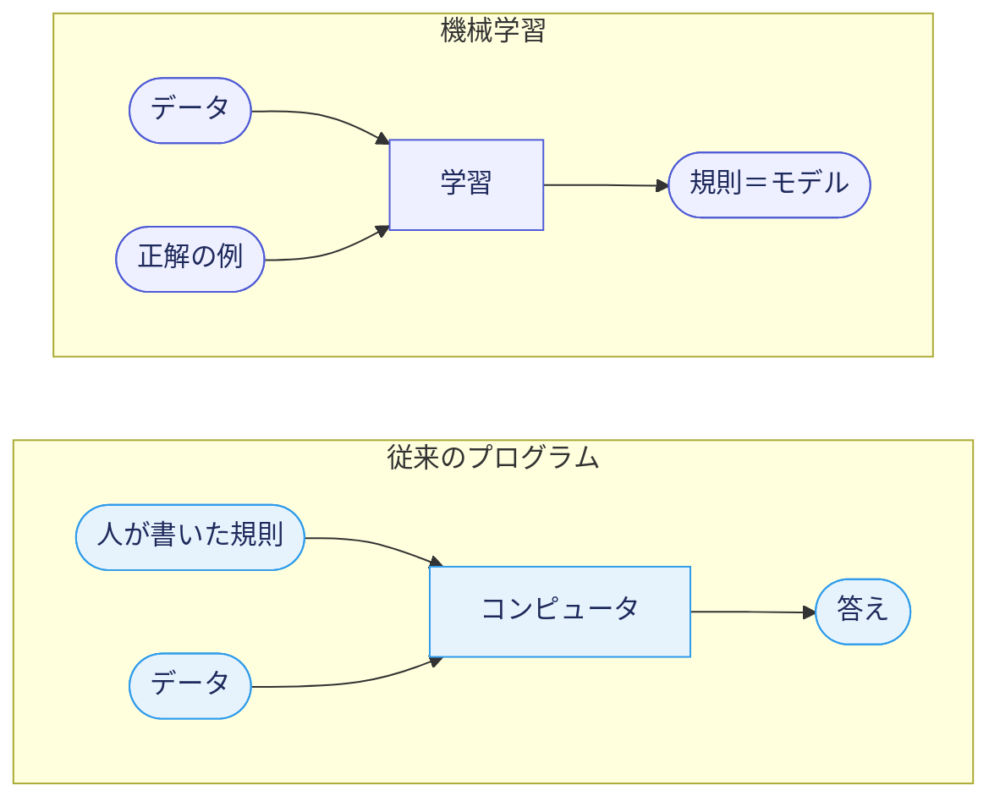

従来のプログラムは「人が規則を書き、データを入れると答えが出る」。機械学習は逆で、「データ（と正解の例）を入れると、規則（**モデル**）ができる」。できたモデルに新しいデータを入れて予測する。

機械学習という言葉は、**アーサー・サミュエル**が1959年の論文で、自分で対局をくり返して強くなるチェッカー（西洋のボードゲーム）のプログラムを発表したころから使われている。また、トム・ミッチェル（1997）は「あるタスクの性能が、経験（データ）によって上がるなら、そのプログラムは学習している」という形で定義した。

**具体例**：迷惑メールの判定（迷惑メールと普通のメールの例から、見分け方を学ぶ）、ネット通販のおすすめ、売上の予測。教師あり学習・教師なし学習・強化学習の3つに分かれる（第4〜6回）。

!!! point "試験ではこう出る"
    - 「人が明示的にプログラムしなくても、データから学習する」が機械学習の特徴。
    - 機械学習は人工知能の一部であり、人工知能のすべてが機械学習ではない（探索やルールベースのAIもある）。

#### ディープラーニング

ディープラーニング（深層学習）T01

<strong>ひとことで：</strong>人間の神経回路をまねた「ニューラルネットワーク」を何層にも深く重ねて使う機械学習の手法。データのどこに注目すればよいか（特徴量）まで自分で学ぶ。

**仕組み**

**特徴量**とは、判断の手がかりになる数値のこと。たとえば「迷惑メールらしさ」なら「"無料"という語の数」「リンクの数」などが特徴量になる。

- **従来の機械学習**：特徴量は**人が考えて**設計する。良い特徴量を選べるかで性能が大きく変わる。
- **ディープラーニング**：生の画像や音声をそのまま入れても、層を重ねる中で、線 → 形 → 部品 → 物体のように、特徴量を**自分で**組み立てていく。

| | 機械学習（従来） | ディープラーニング |
|---|---|---|
| 関係 | AIの一部 | 機械学習の一部 |
| 特徴量 | 人が設計する | データから自動で学ぶ |
| 必要なデータ | 比較的少なくても動く | 大量のデータと計算力が必要 |
| 得意なこと | 表形式のデータ | 画像・音声・文章 |

**具体例**：顔認証、音声アシスタント、機械翻訳、ChatGPTのような大規模言語モデル。2012年の画像認識コンテスト（ILSVRC）での大勝をきっかけに一気に広まった（くわしくは第3回）。

!!! point "試験ではこう出る"
    - 「特徴量を人が設計せず、データから自動的に獲得できる」がディープラーニングの最大の特徴。
    - 「ディープラーニングは機械学習とは別の技術」は誤り。機械学習の一種である。

### B. 知能をどうはかる？（T02）

#### ダートマス会議

ダートマス会議T02

<strong>ひとことで：</strong>1956年の夏に米国のダートマス大学で開かれた研究集会。「人工知能（Artificial Intelligence）」という言葉が、ここで研究分野の名前として使われ始めた。

**仕組み（何があったか）**

- **提案書**：1955年8月31日付で、**ジョン・マッカーシー**、**マービン・ミンスキー**、ナサニエル・ロチェスター、**クロード・シャノン**の4人が出した。「学習や知能のあらゆる面は、原理的には機械でまねできるほど正確に記述できるはずだ」という考えのもとで、2か月・10人の研究会を提案した。
- **「人工知能」という言葉**：この提案書のタイトルに「Artificial Intelligence」が使われた。名づけ親はマッカーシーとされる。
- **参加者**：アレン・ニューウェルとハーバート・サイモンなども参加し、のちのAI研究の中心人物が集まった。

**具体例**：この会議から、探索・推論を中心とする**第1次AIブーム**（1950年代後半〜1960年代）が始まる（第2回）。

!!! point "試験ではこう出る"
    - 「1956年」「人工知能という言葉が初めて使われた」「マッカーシー」の組み合わせ。
    - チューリングテスト（1950年）のほうが**先**。年の順番を問う問題に注意。

#### チューリングテスト

チューリングテストT02

<strong>ひとことで：</strong>人間の判定者が、相手を見ないで文字だけで会話し、相手が人間か機械かを見分けられなければ、その機械には知能があるとみなすテスト。

**仕組み**

<figure markdown>
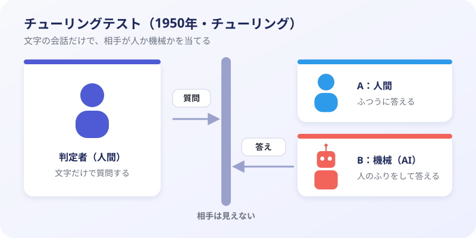
<figcaption>図：チューリングテスト。見分けられなければ「知能あり」とみなす</figcaption>
</figure>

イギリスの数学者**アラン・チューリング**が、1950年の論文「計算する機械と知性（Computing Machinery and Intelligence）」で、「**模倣ゲーム**」として提案した。「機械は考えることができるか？」という問いは、「考える」の意味があいまいで答えられない。そこで、**外から見たふるまい**（会話）で判定する方法に置きかえた。

チューリングは、約50年後（2000年ごろ）には、5分間の会話のあとで平均的な判定者が正しく見分けられる確率は70%以下になるだろう、と予想した。

**その後の出来事**

- 2014年：「13歳のウクライナの少年」という設定のプログラム「ユージーン・グーストマン」が、審査員の33%に人間と思わせたと発表された。ただし、設定でごまかしているなどの批判が多い。
- 2025年：米カリフォルニア大学サンディエゴ校の研究者が、GPT-4.5に人間らしい人物像を演じさせると、判定者の73%が「こちらが人間」と答えたと報告した（判定者・人間・AIの3者で行う形式）。

**似た用語との違い**

| | チューリングテスト | 中国語の部屋 |
|---|---|---|
| 提案者・年 | チューリング・1950年 | サール・1980年 |
| 主張 | ふるまいが人間と区別できなければ知能があるとみなす | ふるまいが正しくても、理解しているとは限らない |
| 立場 | 外から見た「ふるまい」で判定 | 内側の「理解・意味」を問題にする |

!!! point "試験ではこう出る"
    - 提案者（**チューリング**）と年（**1950年**）。「ダートマス会議で提案された」は誤り。
    - 「中国語の部屋」は、チューリングテストのような「ふるまいによる判定」への**反論**として出される。

#### ローブナーコンテスト

ローブナーコンテストT02

<strong>ひとことで：</strong>チューリングテストの考え方で、最も人間らしい会話をするプログラムを競う大会。1991年に始まった。

**仕組み**

米国の実業家**ヒュー・ローブナー**が賞金を出して始めた。審査員がコンピュータの画面ごしに人間やプログラムと会話し、最も人間らしいと判断されたプログラムに賞が贈られる。

- 毎年の優勝（最も人間らしいプログラム）には銅メダルと賞金が出た。
- 審査員を完全にだませたら銀メダル、音声や映像も含めて人間と区別できなければ金メダル、という上の賞も用意されたが、**どちらも一度も授与されなかった**。
- 2019年の大会（英スウォンジー大学）では、チャットボット「Mitsuku（ミツク）」が2016年からの4連覇を果たした。ローブナー氏が2016年に亡くなって資金がなくなり、**2019年が最後の開催**とされる。

!!! point "試験ではこう出る"
    - 「チューリングテストを実際に行う大会」＝ローブナーコンテスト。
    - 「金メダルを獲得したプログラムがある」は誤り。

#### 強いAIと弱いAI

強いAIと弱いAIT02

<strong>ひとことで：</strong>米国の哲学者<strong>ジョン・サール</strong>（1980年）の分け方。<strong>強いAI</strong>は「本当に心をもち、理解しているAI」、<strong>弱いAI</strong>は「心はなく、知的にふるまう便利な道具としてのAI」。

**仕組み**

サールは、1980年の論文「心・脳・プログラム（Minds, Brains, and Programs）」で、AIに対する2つの立場を区別した。

- **強いAI**：適切にプログラムされたコンピュータは、人間と同じように**本当に心をもち、理解している**とする立場。
- **弱いAI**：コンピュータは心を研究したり、知的な作業を手伝ったりする**道具**にすぎないとする立場。

サール自身は、次の「中国語の部屋」を使って**強いAIは実現できない**と主張した。

**具体例**：今の翻訳AIや画像認識AIは「弱いAI」として使われている。人間と同じ心をもつAIは、まだ実現していない。

| | 強いAI・弱いAI | 汎用AI・特化型AI |
|---|---|---|
| 分ける観点 | 心や理解を**もつか** | できる仕事の**幅** |
| 例 | 強いAI＝心をもつAI | 汎用AI＝何でもこなせるAI |
| 由来 | サール（1980年） | 能力の範囲による分類 |

!!! trap "ひっかけ注意"
    「強いAI＝汎用AI」「弱いAI＝特化型AI」と同じ意味で使われることもあるが、**もともとの観点は違う**。サールの「強い・弱い」は**心（理解）があるかどうか**の区別だ。

#### 中国語の部屋

中国語の部屋T02

<strong>ひとことで：</strong>規則どおりに記号を操作して正しく答えられても、意味を理解しているとは限らないことを示す思考実験。サールが1980年に発表し、強いAIを批判した。

**仕組み**

<figure markdown>
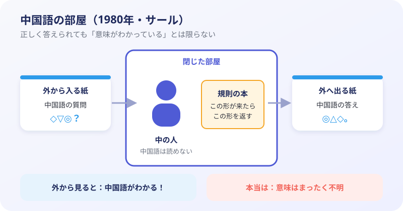
<figcaption>図：中国語の部屋。正しく答えられることと、理解していることは別</figcaption>
</figure>

1. 部屋の中に、**中国語がまったくわからない人**がいる。手元には「この形の記号が来たら、この形の記号を返せ」と書かれた**規則の本**がある。
2. 外から中国語の質問を書いた紙が入ってくる。中の人は規則の本を見て、記号を並べた紙を外に出す。
3. 外の人には、部屋が中国語を理解して答えているように見える。しかし、中の人は**意味を何も理解していない**。

コンピュータも同じで、プログラム（規則）どおりに記号を処理しているだけなら、チューリングテストに合格しても「理解している（心がある）」とは言えない、というのがサールの主張だ。

!!! point "試験ではこう出る"
    - 提案者は**サール**、年は**1980年**、目的は**強いAIへの批判**。
    - 「チューリングテストに合格しても知能があるとは言えない」という主張とセットで覚える。

### C. AIの難問（T02）

AIを実際に作ろうとすると、何度も大きな壁にぶつかった。まずブームごとの壁を整理しておく。

<figure markdown>
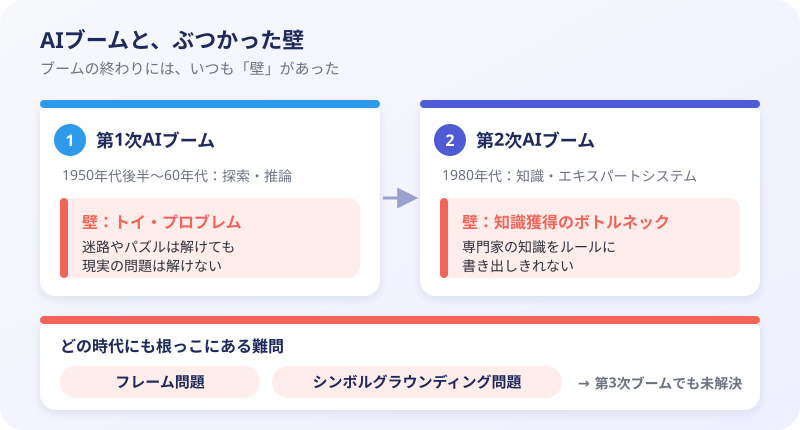
<figcaption>図：AIブームとぶつかった壁</figcaption>
</figure>

#### トイ・プロブレム

トイ・プロブレムT02

<strong>ひとことで：</strong>迷路・パズル・ゲームのように、ルールとゴールがはっきり決まった「おもちゃの問題」。第1次AIブームのAIは、これは解けても現実の複雑な問題は解けなかった。

**仕組み**

第1次AIブーム（1950年代後半〜1960年代）のAIは、「探索」と「推論」で問題を解いた。迷路なら、分かれ道をすべて試せばいつかゴールに着く。ハノイの塔（円盤を移すパズル）も、ルールが決まっているので手順を探せる（第2回）。

ところが、現実の問題（病気の診断、会社の経営判断など）は、ルールがあいまいで、考えるべきことが無数にある。そのため「AIはトイ・プロブレムしか解けない」と失望が広がり、1970年代にブームは終わった（「AIの冬」）。

**具体例**：迷路、ハノイの塔、オセロやチェスのようなボードゲーム、積み木を動かすだけの小さな世界。

!!! point "試験ではこう出る"
    - 「**第1次**AIブームの限界」＝トイ・プロブレム。「第2次」と入れ替えたひっかけに注意。

#### 知識獲得のボトルネック

知識獲得のボトルネックT02

<strong>ひとことで：</strong>専門家の知識を聞き出して、コンピュータが使えるルールに書き起こす作業が、膨大で難しいという問題。第2次AIブームのエキスパートシステムの壁になった。

**仕組み**

第2次AIブーム（1980年代）では、専門家の知識をルールとして大量に入れた「**エキスパートシステム**」が作られた（例：感染症の診断を助けるMYCIN。第2回）。しかし、次のような問題があった。

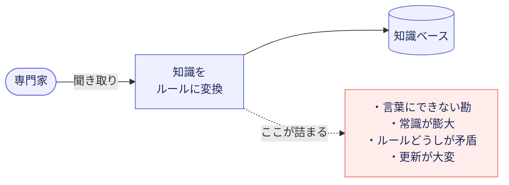

- 専門家の知識には、言葉にしにくい「勘」や「コツ」（暗黙知）が多い。
- 人間がふつうにもっている**常識**は、量が膨大で書き出しきれない。
- ルールが何千と増えると、ルールどうしの矛盾が起き、保守や更新も大変になる。

「ボトルネック」は瓶の首のこと。全体の流れを細くして詰まらせる場所をたとえている。知識を入れる入口が細すぎて、システムが大きくならなかった。

**具体例**：常識をすべて手で書き込もうとするCycプロジェクト（1984年〜。第2回）は、この問題に正面から挑んだ例だ。のちの機械学習は「知識をデータから自動で学ぶ」ことで、この壁を回り込もうとした。

!!! point "試験ではこう出る"
    - 「**第2次**AIブーム」「エキスパートシステム」「専門家からの知識の獲得が難しい」とセットで問われる。

#### フレーム問題

フレーム問題T02

<strong>ひとことで：</strong>処理能力に限りがあるAIが、今の課題に<strong>関係あることだけを選び出して</strong>考えることの難しさ。1969年に<strong>ジョン・マッカーシーとパトリック・ヘイズ</strong>が提起した。

**仕組み**

<figure markdown>
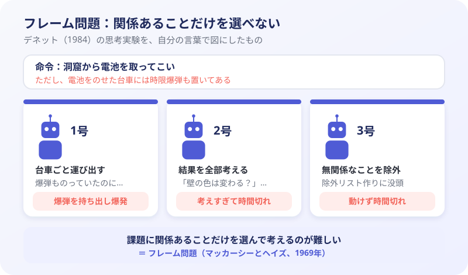
<figcaption>図：フレーム問題。関係あることだけを選ぶのが難しい</figcaption>
</figure>

哲学者**ダニエル・デネット**（1984年）は、ロボットの思考実験でこの問題をわかりやすく示した。ここでは自分の言葉で要約する（デネットの論文では、ロボットはR1、R1D1、R2D1と呼ばれる）。

1. **1号**：「電池を取ってこい」と命じられ、電池がのった台車ごと運び出す。台車には爆弾ものっていたので、爆発してしまう。→ 行動の「副作用」を考えていない。
2. **2号**：1号を改良し、行動の結果を全部考えるようにした。すると「台車を動かしたら壁の色は変わるか？」など、無関係なことまで考え続けて時間切れになる。
3. **3号**：さらに改良し、「関係ないことは考えない」ようにした。すると今度は「これは関係ないか？」を1つずつ確かめるのに没頭し、やはり動けないまま爆発する。

世界には考えられることが無限にあるので、「どこまで考えればよいか」の**枠（フレーム）**を決めるのが難しい。人間もこの問題を完全に解いているわけではないが、ふだんはうまく対処できているように見える。

**具体例**：自動運転車は、道路の白線や歩行者には注意すべきだが、空の雲の形はふつう無視してよい。何が関係して何が関係ないかを、あらゆる状況で正しく決めるのは難しい。

!!! point "試験ではこう出る"
    - 「今しようとしていることに関係のあることがらだけを選び出すことが難しい」という説明から「フレーム問題」を選ぶ。JDLA公式の例題（G2024#4）でも題材になっている。
    - 提起したのは**マッカーシーとヘイズ（1969年）**。ロボットの例えは**デネット**。

#### シンボルグラウンディング問題

シンボルグラウンディング問題（記号接地問題）T02

<strong>ひとことで：</strong>記号（言葉）と、それが指す実世界の意味を、コンピュータがどうやって結びつけるかという問題。1990年に<strong>スティーブン・ハルナッド</strong>が提起した。

**仕組み**

<figure markdown>

<figcaption>図：シンボルグラウンディング問題。記号が実物に「接地」しているか</figcaption>
</figure>

たとえば「シマウマ ＝ しま模様のあるウマ」という定義をコンピュータに教えたとする。人間なら、ウマもしま模様も見たことがあるので、初めてシマウマを見ても「あれだ」とわかる。しかしコンピュータにとって「シマ」も「ウマ」もただの記号で、実物のイメージと結びついて（**接地して**）いない。辞書の中で記号から記号へたどるだけでは、意味にたどり着けない、というのがこの問題だ。

**具体例**：大規模言語モデルは、言葉どうしの関係を大量の文章から学んで自然な文章を書ける。それでも「言葉の意味を本当に理解しているのか」は今も議論が続いている（中国語の部屋と同じ種類の問い）。

| | フレーム問題 | シンボルグラウンディング問題 |
|---|---|---|
| ひとことで | 関係あることだけを選べない | 記号と意味を結びつけられない |
| 提起 | マッカーシーとヘイズ・1969年 | ハルナッド・1990年 |
| 有名な例 | 爆弾と電池のロボット | シマウマ＝シマ＋ウマ |

!!! trap "ひっかけ注意"
    フレーム問題とシンボルグラウンディング問題の説明を入れ替えた選択肢がよく出る。「**選べない**」ならフレーム問題、「**結びつかない（意味がわからない）**」ならシンボルグラウンディング問題。

#### 身体性

身体性T02

<strong>ひとことで：</strong>知能が成り立つには、身体を通して環境とかかわる経験（見る・さわる・動く）が必要だとする考え方。

**仕組み**

人間は「熱い」という言葉の意味を、辞書ではなく、熱いものにさわった経験で知っている。身体性の考え方では、このように**体で世界にふれる経験**が、記号と意味を結びつける土台になると考える。つまり、シンボルグラウンディング問題を解く手がかりとして注目されている。

ロボット研究者の**ロドニー・ブルックス**は、頭の中に世界の細かい模型を作らなくても、センサーと動きの組み合わせで知的にふるまうロボットを作れることを示した（1980年代後半〜）。ロルフ・ファイファーらも、体のつくりが知能のあり方を決めるという研究を進めた。

**具体例**：赤ちゃんは、物をつかむ・なめる・落とすといった体験をくり返して「重い」「やわらかい」を覚える。ロボットに実際に物をさわらせて学ばせる研究も、この考え方に近い。

!!! point "試験ではこう出る"
    - 「知能の成立には身体が不可欠」という説明から「身体性」を選ぶ。
    - シンボルグラウンディング問題とセットで出やすい。

### D. 機械翻訳の移り変わり（T02）

機械翻訳は、AIの考え方の変化がいちばんよく見える分野だ。「人が規則を書く」から「データから学ぶ」へと変わってきた。

<figure markdown>
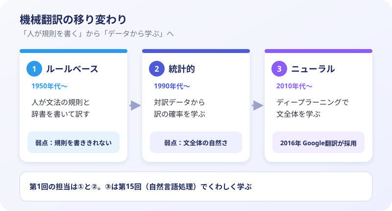
<figcaption>図：機械翻訳の3つの世代</figcaption>
</figure>

#### ルールベース機械翻訳

ルールベース機械翻訳T02

<strong>ひとことで：</strong>人が作った文法の規則と辞書にもとづいて訳す、初期の機械翻訳の方式。

**仕組み**：①入力文を文法の規則で分解する（主語・動詞・目的語など）→ ②辞書で単語を訳す → ③訳す先の言語の語順の規則で並べ直す。たとえば「I eat an apple.」なら、「主語＋動詞＋目的語」を「主語＋目的語＋動詞」に並べかえて「私はりんごを食べる」とする。

**歴史**：1954年、米ジョージタウン大学とIBMが、ロシア語の文を英語に訳す公開実験を行い、大きな期待を集めた。しかし1966年の報告書（ALPAC報告）で「期待したほど実用にならない」と評価され、米国では研究費が大きく減った。

**弱点**：言葉には例外や、文脈で意味が変わる表現が無数にある。規則を人が書ききることはできず、規則を増やすほど矛盾も増えた。これは知識獲得のボトルネックと同じ種類の問題だ。

#### 統計的機械翻訳

統計的機械翻訳T02

<strong>ひとことで：</strong>大量の対訳データ（同じ内容の2言語の文の組）から、単語や句がどう対応するかの確率を学び、いちばんありそうな訳を選ぶ機械翻訳。

**仕組み**

1990年ごろにIBMの研究グループが本格的な方法を発表し、2000年代に主流になった。人が文法の規則を書く代わりに、**対訳コーパス**（大量の対訳文を集めたデータ）から統計的に学ぶ。Google翻訳も最初はこの方式だった。

!!! formula "数式で見ると"
    考え方はシンプルで、「**元の文の意味をちゃんと表していて**、しかも**訳文として自然な**文」を選ぶ。2つの点数のかけ算が最大になる訳を探す。

    $$
    \hat{e} = \underset{e}{\operatorname{argmax}}\ P(f \mid e)\, P(e)
    $$

    - \(f\)：元の文（訳したい文）、\(e\)：訳文の候補
    - \(P(f \mid e)\)：**翻訳モデル**。訳文 \(e\) と元の文 \(f\) の意味がどれくらい対応しているか
    - \(P(e)\)：**言語モデル**。訳文 \(e\) がその言語の文としてどれくらい自然か
    - \(\operatorname{argmax}_e\)：値がいちばん大きくなる \(e\) を選ぶ、という意味。\(\hat{e}\) が選ばれた訳

**その後**：統計的機械翻訳は単語や句の単位で訳すため、文全体として不自然になりやすかった。2016年9月、Googleはディープラーニングを使う**ニューラル機械翻訳**（GNMT）を発表し、まず中国語→英語から切り替えた（第15回）。

| | ルールベース機械翻訳 | 統計的機械翻訳 |
|---|---|---|
| 訳し方の元 | 人が書いた文法規則と辞書 | 対訳データから学んだ確率 |
| 主流の時期 | 1950年代〜1980年代 | 1990年代〜2010年代前半 |
| 弱点 | 規則を書ききれない | 文全体の自然さが苦手 |
| AIの流れ | 知識を人が入れる | データから学ぶ（機械学習） |

!!! point "試験ではこう出る"
    - 「対訳コーパスから確率を学ぶ」＝統計的機械翻訳、「人が文法規則を書く」＝ルールベース機械翻訳。
    - 時代の順番は **ルールベース → 統計的 → ニューラル**。

### E. 未来の予測（T02）

#### シンギュラリティ

シンギュラリティ（技術的特異点）T02

<strong>ひとことで：</strong>AIが人間の知能を超え、AIがさらに賢いAIを生み出すことで、その後の変化を人間が予測できなくなるとされる転換点。

**仕組み**

<figure markdown>
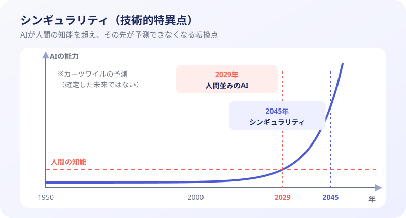
<figcaption>図：シンギュラリティのイメージ（予測であり確定した未来ではない）</figcaption>
</figure>

- 1965年、数学者アーヴィング・J・グッドは、人間より賢い機械ができれば、それがさらに賢い機械を設計し、知能が爆発的に伸びる（**知能爆発**）と論じた。
- 1993年、SF作家で数学者のヴァーナー・ヴィンジが「技術的特異点」という言葉を広めた。
- **レイ・カーツワイル**は、2005年の著書『シンギュラリティは近い（The Singularity Is Near）』で、技術は指数関数的に進歩する（**収穫加速の法則**）と主張し、**2045年**にシンギュラリティが来ると予測した。2029年には人間並みの知能をもつAIが現れるとも予測している。

!!! news "最新動向（確認日：2026-11-25）"
    カーツワイルは2024年6月の続編『The Singularity Is Nearer』でも、**2029年に人間並みのAI、2045年にシンギュラリティ**という予測を変えていない。一方で、シンギュラリティが本当に来るかどうかについては、研究者の間でも意見が大きく分かれている。

!!! point "試験ではこう出る"
    - 「カーツワイル」「2045年」「収穫加速の法則」の組み合わせ。
    - 「シンギュラリティはすでに到来した」「到来が確定している」は誤り。あくまで**予測**だ。

## 身近な具体例

!!! life "新人アシスタント「エーアイくん」の1日"
    会社に、新人のロボットアシスタント**エーアイくん**（観測して行動する**エージェント**）がやってきた。

    - **朝**：チャットで仕事の相談を受ける。相手は人間だと思っていたが、実はエーアイくんだった。これは**チューリングテスト**に合格した状態だ。でも先輩は「マニュアルどおり答えているだけで、意味はわかっていないかもね」と言う（**中国語の部屋**）。エーアイくんは道具として役に立つ**弱いAI**であって、心をもつ**強いAI**かどうかはわからない。
    - **昼**：「コピー用紙を取ってきて」と頼むと、倉庫で「棚を動かしたら天井の照明は変わる？」と考え込んで戻ってこない（**フレーム問題**）。
    - **午後**：「お客様が"いい感じに"と言ったら、どうすればいい？」と聞かれても、ベテランの勘は言葉にできず、ルールに書けない（**知識獲得のボトルネック**）。エーアイくんは「ふわふわ」という言葉を知っていても、さわったことはない（**シンボルグラウンディング問題**・**身体性**）。
    - **夕方**：英語のメールを訳す。昔の翻訳ソフトは文法規則どおりに訳して不自然だったが（**ルールベース機械翻訳**）、今は大量の例文から学んで自然に訳す（**統計的機械翻訳**→ニューラル）。
    - **1年後**：エーアイくんがすっかり職場に溶けこむと、誰も「AIだ」と言わなくなった（**AI効果**）。社長は「いつか人間を超える日が来るのか」と考える（**シンギュラリティ**）。

## 試験に出るポイントとひっかけ

!!! point "ここは必ず覚える（人名・年）"
    | 年 | 出来事 | 人物 |
    |---|---|---|
    | 1950 | チューリングテスト | チューリング |
    | 1956 | ダートマス会議（「人工知能」の名前） | マッカーシーら |
    | 1969 | フレーム問題 | マッカーシーとヘイズ |
    | 1980 | 中国語の部屋・強いAIと弱いAI | サール |
    | 1990 | シンボルグラウンディング問題 | ハルナッド |
    | 1991 | ローブナーコンテスト開始 | ローブナー |
    | 2005 | 2045年シンギュラリティ予測 | カーツワイル |

!!! trap "ひっかけ注意"
    - **フレーム問題 ⇔ シンボルグラウンディング問題**の説明の入れ替え。「関係あることを選べない」か「記号と意味が結びつかない」か。
    - **トイ・プロブレム（第1次） ⇔ 知識獲得のボトルネック（第2次）**のブームの入れ替え。
    - 「強いAI＝汎用AI」と決めつける選択肢。サールの区別は「心・理解があるか」。
    - 「中国語の部屋はチューリングが提案した」は誤り。**サール**。チューリングテストを**批判する側**の思考実験。
    - 「AI効果」は「AIを使うと業務の効果が上がること」ではない。
    - 「ディープラーニングは機械学習とは別物」は誤り。機械学習の一種。

!!! memory "覚え方"
    - **年の順番**は「チューリング（50）→ダートマス（56）→フレーム（69）→部屋（80）→グラウンディング（90）」。**テスト → 会議 → 枠 → 部屋 → 地面（グラウンド）**と、場面が「外へ出ていく」イメージで並べる。
    - **フ**レーム問題は「**フ**るいにかけられない（選べない）」、**シ**ンボルグラウンディングは「**シ**マウマ」。
    - **サール**は「**去る**（サール）、部屋から出ても意味はわからない」。

## まとめ：覚えるべき用語

| 用語 | ひとことで | セットで覚える |
|---|---|---|
| 人工知能 | 人間の知的なふるまいを機械で実現する技術。定義は統一されていない | マッカーシー、AIのレベル分け |
| AI効果 | 実現した技術がAIと呼ばれなくなる現象 | 「ただの自動化」 |
| エージェント | 環境を観測し、行動を選んで実行する主体 | センサー、アクチュエータ |
| 機械学習 | データから規則やパターンを学ぶ手法 | サミュエル（1959）、AIの一部 |
| ディープラーニング | 多層のニューラルネットワークで特徴量まで学ぶ | 機械学習の一部、特徴量 |
| ダートマス会議 | 1956年、「人工知能」という言葉が使われ始めた研究集会 | マッカーシー、ミンスキー、シャノン |
| チューリングテスト | 文字の会話で人か機械か見分けられなければ知能ありとみなす | チューリング、1950年、模倣ゲーム |
| ローブナーコンテスト | チューリングテスト形式で人間らしさを競う大会 | 1991年開始、2019年が最後 |
| 強いAIと弱いAI | 心をもつAIか、道具としてのAIか | サール、1980年 |
| 中国語の部屋 | 記号操作ができても理解とは限らない | サール、強いAI批判 |
| トイ・プロブレム | ルールとゴールが明確な簡単な問題 | 第1次AIブームの壁 |
| 知識獲得のボトルネック | 専門家の知識をルールに書き出しきれない | 第2次AIブーム、エキスパートシステム |
| フレーム問題 | 関係あることだけを選び出せない | マッカーシーとヘイズ（1969）、デネット |
| シンボルグラウンディング問題 | 記号と実世界の意味を結びつけられない | ハルナッド（1990）、シマウマ |
| 身体性 | 知能には体を通した経験が必要という考え方 | ブルックス、記号接地 |
| ルールベース機械翻訳 | 人が書いた文法規則と辞書で訳す | 初期の機械翻訳、ALPAC報告 |
| 統計的機械翻訳 | 対訳データから確率を学んで訳す | 対訳コーパス、IBM |
| シンギュラリティ | AIが人間を超え、その先が予測できなくなる転換点 | カーツワイル、2045年 |

## 確認テスト

**問1** 「AI効果」の説明として、最も適切なものを1つ選べ。

1. AIを業務に導入すると、作業の効率が大きく上がる効果
2. AIで実現された技術の仕組みがわかると、人々がそれを知能とは考えなくなり、AIと呼ばなくなる現象
3. AIが自分より賢いAIを作り、知能が爆発的に伸びていく現象
4. AIの判断に人間が頼りすぎて、自分で考えなくなる現象

??? success "答えと解説（タップで開く）"
    **正解：2**

    - 1：業務の効率化はAI導入の一般的なメリットで、「AI効果」という用語の意味ではない。
    - 2：正しい。実現した技術が「ただの自動化」とみなされ、AIと呼ばれなくなる現象がAI効果。
    - 3：知能爆発やシンギュラリティの説明。
    - 4：AIへの過度な依存の説明で、AI効果ではない。

**問2** 「処理能力に限りのあるAIが、今しようとしていることに関係のあることがらだけを選び出して考えるのは難しい」という問題を何というか。

1. シンボルグラウンディング問題
2. 知識獲得のボトルネック
3. トイ・プロブレム
4. フレーム問題

??? success "答えと解説（タップで開く）"
    **正解：4**

    - 1：記号と実世界の意味を結びつけられない問題。「選べない」ではない。
    - 2：専門家の知識をルールに書き出すのが難しい問題（第2次AIブームの壁）。
    - 3：ルールとゴールが明確な簡単な問題のこと。
    - 4：正しい。マッカーシーとヘイズが1969年に提起したフレーム問題。

**問3** 「中国語の部屋」に関する説明として、最も適切なものを1つ選べ。

1. ジョン・サールが、記号を規則どおりに操作できても意味を理解しているとは限らないことを示し、強いAIを批判するために考えた
2. アラン・チューリングが、機械が知能をもつかどうかを判定する方法として提案した
3. 中国語を正しく訳せる機械は、意味を理解していると証明した思考実験である
4. ダートマス会議で発表され、第1次AIブームのきっかけになった

??? success "答えと解説（タップで開く）"
    **正解：1**

    - 1：正しい。サールが1980年に発表した思考実験で、強いAIへの批判が目的。
    - 2：チューリングテストの説明。中国語の部屋はむしろその考え方への反論。
    - 3：逆。正しく答えられても理解しているとは限らない、という主張。
    - 4：ダートマス会議は1956年。中国語の部屋は1980年で関係ない。

**問4** チューリングテストに関する説明として、最も適切なものを1つ選べ。

1. 1956年のダートマス会議で、マッカーシーが提案した
2. 機械の計算速度が人間を超えたかどうかを調べるテストである
3. 判定者が文字だけで会話し、相手が人間か機械かを見分けられなければ、機械に知能があるとみなす
4. このテストに合格すれば、機械が意味を理解していることが証明されるというのが、学界で一致した見解である

??? success "答えと解説（タップで開く）"
    **正解：3**

    - 1：チューリングテストはアラン・チューリングが1950年に提案した。ダートマス会議より前。
    - 2：計算速度ではなく、会話のふるまいで判定する。
    - 3：正しい。
    - 4：中国語の部屋のように「合格しても理解しているとは限らない」という反論があり、見解は一致していない。

**問5** 「シマウマはしま模様のあるウマだ」と記号で教えても、シマもウマも見たことがないコンピュータは本物のシマウマを見分けられない。この例で説明される問題を提起した人物と問題名の組み合わせとして、最も適切なものを1つ選べ。

1. ジョン・マッカーシー ― フレーム問題
2. ジョン・サール ― 中国語の部屋
3. スティーブン・ハルナッド ― シンボルグラウンディング問題
4. ダニエル・デネット ― 身体性

??? success "答えと解説（タップで開く）"
    **正解：3**

    - 1：フレーム問題は「関係あることを選べない」問題（マッカーシーとヘイズ）。
    - 2：中国語の部屋は「記号操作ができても理解とは限らない」思考実験。近い話題だが、シマウマの例はシンボルグラウンディング問題。
    - 3：正しい。ハルナッドが1990年に提起した。
    - 4：デネットはフレーム問題をロボットの例えで説明した哲学者。

**問6** 人工知能・機械学習・ディープラーニングの関係として、最も適切なものを1つ選べ。

1. 人工知能の中に機械学習があり、機械学習の中にディープラーニングがある
2. 機械学習の中に人工知能があり、人工知能の中にディープラーニングがある
3. ディープラーニングと機械学習は別の技術で、どちらも人工知能の一部である
4. 3つは同じものを別の名前で呼んでいるだけである

??? success "答えと解説（タップで開く）"
    **正解：1**

    - 1：正しい。AI ⊃ 機械学習 ⊃ ディープラーニングの入れ子。
    - 2：包含関係が逆。
    - 3：ディープラーニングは機械学習の一種なので「別の技術」ではない。
    - 4：範囲が違う。探索やルールベースのAIは、AIだが機械学習ではない。

**問7** 専門家の知識を聞き出してルールとして書き起こす作業が膨大で難しく、エキスパートシステムの広がりを妨げた問題を何というか。また、それが壁になったのはどの時期か。

1. トイ・プロブレム ― 第1次AIブーム
2. 知識獲得のボトルネック ― 第1次AIブーム
3. トイ・プロブレム ― 第2次AIブーム
4. 知識獲得のボトルネック ― 第2次AIブーム

??? success "答えと解説（タップで開く）"
    **正解：4**

    - 1：トイ・プロブレムは第1次AIブームの壁だが、問題文の内容（専門家の知識）とは違う。
    - 2：問題名は合っているが、時期が違う。エキスパートシステムは第2次AIブーム（1980年代）。
    - 3：問題名も時期の組み合わせも違う。
    - 4：正しい。

**問8** 統計的機械翻訳の説明として、最も適切なものを1つ選べ。

1. 言語学者が作った文法の規則と辞書にもとづいて訳す
2. 大量の対訳データから単語や句の対応の確率を学び、もっともらしい訳を選ぶ
3. 深いニューラルネットワークで文全体をまとめて学習し、訳文を生成する
4. 人間の翻訳者が訳した結果をデータベースに保存し、同じ文が来たらそのまま返す

??? success "答えと解説（タップで開く）"
    **正解：2**

    - 1：ルールベース機械翻訳の説明。
    - 2：正しい。翻訳モデルと言語モデルの確率を組み合わせて訳を選ぶ。
    - 3：ニューラル機械翻訳の説明（2016年にGoogle翻訳が採用）。
    - 4：保存した訳を返すだけで、確率を学ぶ統計的機械翻訳とは違う。

**問9** シンギュラリティ（技術的特異点）について、著書で「2045年」に到来すると予測したことで知られる人物として、最も適切なものを1つ選べ。

1. ジョン・サール
2. アラン・チューリング
3. レイ・カーツワイル
4. ヒュー・ローブナー

??? success "答えと解説（タップで開く）"
    **正解：3**

    - 1：サールは「中国語の部屋」「強いAIと弱いAI」の哲学者。
    - 2：チューリングは1950年にチューリングテストを提案した数学者。
    - 3：正しい。2005年の著書『シンギュラリティは近い』で2045年と予測した。
    - 4：ローブナーはローブナーコンテストに賞金を出した実業家。

**問10** 1956年のダートマス会議に関する説明として、最も適切なものを1つ選べ。

1. この会議の提案書で「人工知能（Artificial Intelligence）」という言葉が使われ、研究分野の名前として広まった
2. この会議でチューリングテストが初めて提案された
3. この会議でエキスパートシステムが発表され、第2次AIブームが始まった
4. この会議で、シンギュラリティが2045年に来ることが合意された

??? success "答えと解説（タップで開く）"
    **正解：1**

    - 1：正しい。マッカーシー、ミンスキー、ロチェスター、シャノンの提案書（1955年）で使われた。
    - 2：チューリングテストは1950年の論文で提案された。
    - 3：エキスパートシステムは1980年代の第2次AIブーム。ダートマス会議は第1次AIブームの始まり。
    - 4：シンギュラリティの2045年説はカーツワイル（2005年）の予測。

## 参考資料

- JDLA「G検定 試験出題範囲（シラバス2024）第1.4版」2026年5月11日 — 担当項目 T01, T02。https://www.jdla.org/download-category/syllabus/
- JDLA「G検定の例題・過去問」（例題Q1がフレーム問題を題材にしている。問題文は転載しない）https://www.jdla.org/certificate/general/issues/
- McCarthy, J., Minsky, M., Rochester, N., Shannon, C. (1955). *A Proposal for the Dartmouth Summer Research Project on Artificial Intelligence*（AI Magazine 27(4), 2006 に再録）. https://ojs.aaai.org/index.php/aimagazine/article/view/1904
- McCarthy, J. (2007年11月最終改訂). *What is Artificial Intelligence?* https://www-formal.stanford.edu/jmc/whatisai/ ：マッカーシー自身によるAIの定義。
- Turing, A. M. (1950). Computing Machinery and Intelligence. *Mind*, 59(236), 433–460. https://doi.org/10.1093/mind/LIX.236.433
- Searle, J. R. (1980). Minds, Brains, and Programs. *Behavioral and Brain Sciences*, 3(3), 417–424. https://doi.org/10.1017/S0140525X00005756
- McCarthy, J., Hayes, P. J. (1969). Some Philosophical Problems from the Standpoint of Artificial Intelligence. *Machine Intelligence 4*, Edinburgh University Press.
- Dennett, D. C. (1984). Cognitive Wheels: The Frame Problem of AI. In C. Hookway (Ed.), *Minds, Machines and Evolution*. Cambridge University Press.
- Harnad, S. (1990). The Symbol Grounding Problem. *Physica D*, 42, 335–346. https://arxiv.org/abs/cs/9906002
- Brooks, R. A. (1991). Intelligence without Representation. *Artificial Intelligence*, 47, 139–159.
- Russell, S., Norvig, P. *Artificial Intelligence: A Modern Approach*（第4版 2020年）：AIをエージェントの研究として説明する標準的な教科書。
- Samuel, A. L. (1959). Some Studies in Machine Learning Using the Game of Checkers. *IBM Journal of Research and Development*, 3(3), 210–229.
- Mitchell, T. M. (1997). *Machine Learning*. McGraw-Hill.
- 松尾豊（2015）『人工知能は人間を超えるか ディープラーニングの先にあるもの』KADOKAWA：AIの定義とレベル分け。
- Brown, P. F. et al. (1990). A Statistical Approach to Machine Translation. *Computational Linguistics*, 16(2), 79–85.
- Google Research Blog (2016-09-27). A Neural Network for Machine Translation, at Production Scale. https://research.google/blog/a-neural-network-for-machine-translation-at-production-scale/ ：統計的機械翻訳からニューラル機械翻訳への切り替え。
- Jones, C. R., Bergen, B. K. (2025). Large Language Models Pass the Turing Test. arXiv:2503.23674. https://arxiv.org/abs/2503.23674 ：GPT-4.5が3者形式のチューリングテストで73%人間と判定された研究（2025年3月公開のプレプリント）。
- Swansea University (2019). Mitsuku wins 2019 Loebner Prize and Best Overall Chatbot at AISB X. https://www.swansea.ac.uk/computational-foundry/news/mitsuku-wins2019loebner-prize/ ：最後のローブナーコンテスト。
- Kurzweil, R. (2005). *The Singularity Is Near*. Viking. ／ Kurzweil, R. (2024). *The Singularity Is Nearer*. Viking：2029年・2045年の予測。
- Vinge, V. (1993). The Coming Technological Singularity. VISION-21 Symposium, NASA Lewis Research Center.
- Good, I. J. (1965). Speculations Concerning the First Ultraintelligent Machine. *Advances in Computers*, 6, 31–88.
