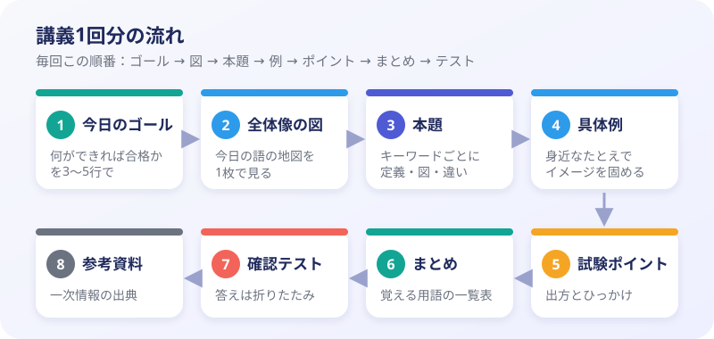
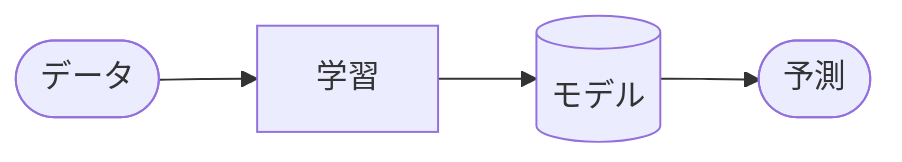

第N回 ｜ パート名（見本）

# デザイン見本

講義とQ&Aノートで使う部品をまとめたページ。**学習内容ではなく、見た目を揃えるための見本**。
部品の書き方は `templates/` と `CLAUDE.md` を見る。

T00 項目名
⏱ 目安60分
キーワード00語

## 講義1回分の流れ

すべての講義はこの順番で並べる。

<figure markdown>

<figcaption>図：講義1回分の流れ（オリジナルSVGの見本）</figcaption>
</figure>

## パートごとのバナー色

P1 AIの全体像と歴史

P2 機械学習

P3 ディープラーニングの基礎

P4 ディープラーニングの要素技術

P5 ディープラーニングの応用例

P6 社会実装と数理・統計

P7 AIに関する法律と契約

P8 AI倫理・AIガバナンス

P9 総仕上げ

## 今日のゴール

この回が終わったら、こう言えればOK

- ゴールは3〜5行
- 「説明できる」「答えられる」「計算できる」で終える
- 試験で問われる形に合わせる

## キーワードカード

### サンプル用語

サンプル用語T00

<strong>ひとことで：</strong>定義を1文で書く場所。ここだけ読めば意味がわかるように。

**仕組み**：直感的な説明 → 図 → くわしい説明の順に書く。

## 手順（①→②→③）

1. **ステップ1**：最初に起きること
2. **ステップ2**：次に起きること
3. **ステップ3**：結果

## 流れ図（Mermaid）

## 数式

!!! formula "数式で見ると"
    先に「何を表しているか」を言葉で書いてから、数式を載せる。例：平均は「全部足して個数で割る」。

    $$
    \bar{x} = \frac{1}{n}\sum_{i=1}^{n} x_i
    $$

## 囲みの種類

!!! goal "goal：ゴール・結論"
    結論やゴールを示すとき。

!!! point "point：試験ではこう出る"
    出題パターン・必ず覚える数値や名前。

!!! trap "trap：ひっかけ注意"
    間違えやすい選択肢と理由。

!!! life "life：身近な具体例"
    日常のたとえ話。

!!! memory "memory：覚え方"
    語呂合わせ・セットで覚えるコツ。

!!! news "news：最新動向"
    法律・ガイドライン・モデルの最新情報（確認日を書く）。

!!! info "info：補足"
    本筋から外れる補足。

## 比較表（似た用語との違い）

| | 用語A | 用語B |
|---|---|---|
| ひとことで | 〇〇する | △△する |
| 目的 | | |
| 例 | | |

## まとめ表

| 用語 | ひとことで | セットで覚える |
|---|---|---|
| 用語A | 定義 | 用語B |

## 確認テスト

**問1** 見本の問題文。最も適切なものを1つ選べ。

1. 選択肢
2. 選択肢
3. 選択肢
4. 選択肢

??? success "答えと解説（タップで開く）"
    **正解：2**

    - 1：違う理由
    - 2：正しい理由
    - 3：違う理由
    - 4：違う理由

## チップと強調

indigo
teal
coral
amber
sky
violet

文中の==マーカー強調==は、本当に大事な所だけに使う。
