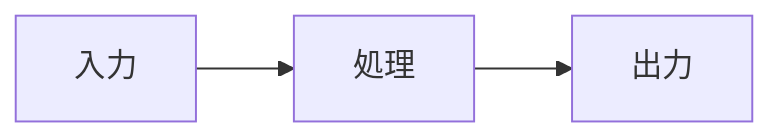

# （ノートのタイトル）

T27 自然言語処理
頻出度 ★★★
関連講義：第15回

!!! info "このノートの位置づけ"
    - **きっかけの質問**：（質問を一言で）
    - **シラバス**：（項目ID 項目名）
    - **作成日**：YYYY-MM-DD

## 1. 結論をひとことで

結論

- （1〜2文で答える）

## 2. 身近なたとえ話

!!! life "（たとえのタイトル）"
    （日常の場面にたとえる）

## 3. 図解

（流れ・手順は Mermaid、構成図やイラストは docs/assets/images/notes/ に置いたオリジナルSVG）

## 4. 仕組み

1. **（ステップ1）**：（説明）
2. **（ステップ2）**：（説明）
3. **（ステップ3）**：（説明）

## 5. 似た用語との比較

| | A | B |
|---|---|---|
| ひとことで | | |
| 仕組み | | |
| 得意なこと | | |
| 代表例 | | |

## 6. 試験での出方とひっかけ

!!! point "よくある問われ方"
    - （例：「〇〇の説明として最も適切なものを選べ」）

!!! trap "ひっかけポイント"
    - （間違えやすい点）

## 7. 参考になる外部資料

図は載せず、リンクと見どころだけ紹介する。

- [（資料名）](https://...)：（どこがわかりやすいか）

## 8. 確認ミニ問題

**問1** （問題文）

1. （選択肢）
2. （選択肢）
3. （選択肢）
4. （選択肢）

??? success "答えと解説（タップで開く）"
    **正解：（番号）**

    - 1：
    - 2：
    - 3：
    - 4：
